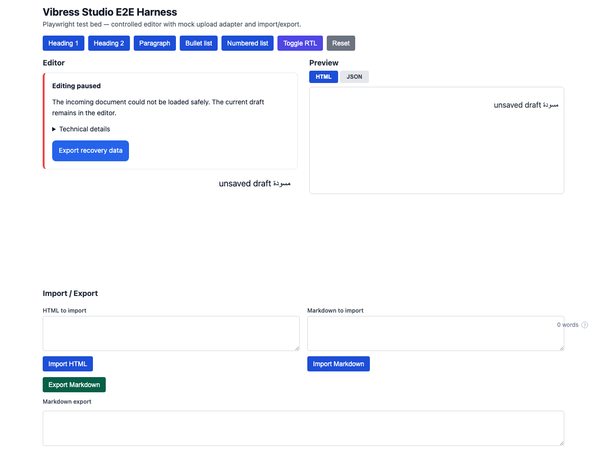
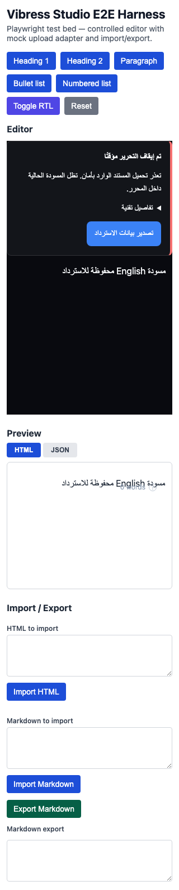

# Production-readiness program implementation record

Date: 2026-11-05. Lead role: document architect/editor integrity, prioritizing
recoverable content over accepting data the pinned editor would discard.
Branch: `codex/studio-production-readiness-program`. Starting source:
`619f23281a748969735dae062a25457ca0b3e519`; prior-package rollback source:
`b86c8e66f1e615eed756b4335de4950b29114181`. Host source compared read-only:
`f56ae8b94d4f1ce45bec380580b9d238ddf8b5c1`.

This tracks implementation across the [12-week PRD](../roadmaps/product-quality-engineering-execution-plan-2026-11-05.md).
It does not compress the required research, owner decisions, independent reviews
and live rollout into an automated coding pass. Tickets below remain open until
their full acceptance criteria and accountable review are satisfied. No quality
score or production certification is awarded.

## Implemented outcomes

- Separate non-destructive persisted validation from strict editable node/card
  admission. Retain unknown metadata, foreign/future originals and invalid roots
  for recovery. Bound size, nodes, JSON depth, complexity and optional string bytes.
- Keep active drafts, selection and history through rejected incoming updates.
  Export original plus live recovery state through an optional host callback;
  offer English/Arabic, pending/error/retry states and repairable outgoing errors.
- Replace simulated uploads with mounted React/Lexical component tests. Guard
  deletion/unmount, stale replacements and gallery partial retries; preserve
  concurrent author metadata, durable IDs and explicit cancellation semantics.
- Apply context-specific URLs and HTML policy regressions. Validate and snapshot
  plugin API v1 registration atomically; sanitize plugin output and document
  in-process trust and unsupported toolbar mounting.
- Run desktop editor journeys on three engines; correct native focus/selection,
  URL keyboard access and Lexical context used for block hover.
- Add versioned compatibility fixtures, clean tarball consumers, scoped package
  rollback, immutable host-core comparison, browser frame benchmarks and a
  comparison command that refuses mismatched environments.
- Lock documentation tooling, gate critical-file branch coverage, retain CI
  artifacts, add a manual pre-release evidence workflow, changelog, PR template,
  release policy and interaction handoff.

## Ticket disposition

“Implemented” means code/documentation exists on this branch and is subject to
the verification below. “Partial” identifies acceptance still outside its scope.
Role labels come from the PRD; named owner assignments remain unapproved.

| Ticket | Implementation and remaining acceptance |
| --- | --- |
| STU-101 | Open: ADR-0001 remains Proposed; named canonical ownership requires Engineering Lead + Host Owner. |
| STU-102 | Partial: existing capability report and new core fixture comparator; commands/rendering/Yjs/service parity still need named-SHA integration evidence. |
| STU-103 | Partial: local automated/coverage/package/frame baselines; real device, memory and production data baseline remain open. |
| STU-201 | Implemented: strict schemas for 18 editable node types, field/version/placement admission; persisted unknown data retained. |
| STU-202 | Implemented: renderer property guards and safe malformed-node/throwing-plugin handling; independent review pending. |
| STU-203 | Implemented: configurable non-truncating limits including per-string bytes; default budgets still need real-content validation. |
| STU-204 | Partial: synthetic versioned fixtures for current/legacy/future/invalid/mixed/table/all-card cases; anonymized historical production corpus absent. |
| STU-205 | Implemented: source/draft recovery, localized host export, pending/error/retry and viewport tests; design acceptance pending. |
| STU-301 | Implemented: local edits, informational revision and deliberate replacement token contract documented. |
| STU-302 | Partial: deterministic stale-echo/external-recovery tests; actual host persistence/reload acceptance remains separate. |
| STU-303 | Partial: mounted-editor/browser continuity coverage; physical IME and all caption/focus combinations require manual review. |
| STU-304 | Open: host owns multi-session conflict policy and server expected revisions; no standalone persistence service added. |
| STU-401 | Implemented: contextual URL schemes, parser checks, character/length policy and new-window protections. |
| STU-402 | Implemented: expanded parser/foreign-markup/CSS/attribute/URL/plugin regression cases; independent adversarial review pending. |
| STU-403 | Existing safety/roundtrip tests retained and rerun; intentionally lossy Markdown behavior documented. |
| STU-404 | Implemented: trusted in-process plugin contract, atomic validation/conflict handling and sanitized output tests. |
| STU-405 | Partial: production audit, static checks, security suite and release policy; independent risk disposition/sign-off pending. |
| STU-501 | Implemented: actual five-media-component lifecycle tests replace the simulated image test. |
| STU-502 | Partial: source/asset merge, admission, serialized fixtures and output tests; real host authorization/storage durability unverified. |
| STU-503 | Partial: state matrix plus valid incomplete-card, pending/cancel/error/retry behavior; full product/design approval pending. |
| STU-504 | Implemented: preserved assets/metadata, stale/unmount guards, same-file retry and partial gallery retry. |
| STU-505 | Partial: real caption/concurrent metadata and browser tests; real Arabic IME/screen readers remain open. |
| STU-701 | Implemented: SDK capability documentation matches registration/cards/slash/rendering; toolbar metadata explicitly reserved. |
| STU-702 | Implemented: API v1 policy, runtime validation, ownership snapshots and unregister lifecycle tests. |
| STU-703 | Partial: extracted admission/recovery/compatibility/media helpers; no speculative rewrite of unprofiled slash-menu internals. |
| STU-704 | Partial: production explicit-any count is zero, deserialization/plugin boundaries tightened; cast review is not exhausted by this scan. |
| STU-705 | Implemented: test paths, sanitizer, integration, readiness and locked docs tooling aligned with source. |
| STU-801 | Partial: seven desktop/emulated mobile workloads with environment/hash and p50/p95 frame proxies; physical devices, INP and sustained memory evidence missing. |
| STU-802 | Open: no performance optimization claimed without an accepted before/after profile. Integrity checks remain in place. |
| STU-803 | Partial: pre-release benchmark artifacts/comparator implemented; stable runner, accepted tolerances and production monitoring remain open. |
| STU-901 | Partial/blocked: shared persisted-core fixtures expose four host differences; renderer/editor/commands/Yjs/service parity not yet exercised. |
| STU-902 | Partial/blocked: clean installation/ESM/CJS/CSS work; strict upstream Lexical declarations fail in Bundler and NodeNext modes. |
| STU-903 | Partial: versioning/release/changelog rules documented; private 0.1.0 remains unchanged pending distribution decision. |
| STU-904 | Open: host-owned staged feature flag and privacy-preserving operational telemetry require host work and release owner. |
| STU-905 | Partial: prior-tarball reinstall and candidate-created v1 root reopen/save demonstrated; deployed-host/draft rollback is unverified. |

## Design deliverables

DES-101–106 are partially addressed by [the interaction handoff](../design-readiness-spec.md),
existing exported design tokens, light/dark styling and automated responsive/RTL
checks. No Figma delivery, usability study, manual contrast/screen-reader/real
mobile acceptance or designer sign-off is claimed. These remain product/design
deliverables, with a named device/reviewer/SHA required for acceptance.

## Release gate status

| Gate | Status and unmet condition |
| --- | --- |
| G0 Architecture | Open: canonical runtime, ownership and scope acceptance. |
| G1 Integrity | Partial: local safety regressions implemented; historical corpus and real host persistence/conflicts remain. |
| G2 Security/reliability | Partial: automated coverage and security checks; independent review and final-candidate CI required. |
| G3 Design/accessibility | Partial: desktop engines and responsive recovery; design, screen-reader and real mobile acceptance required. |
| G4 Performance | Open: reproducible proxies exist; accepted device/budget, INP and memory evidence required. |
| G5 Integration | Blocked: host differences and strict dependency declarations; deployed rollback not demonstrated. |
| G6 Release | Open: independent engineering/security/design/product/release approval and staged host rollout required. |

## Verification ledger

Local results below cover the source in `a08c31b` and `4a51f68` plus the program
verification tooling. Final PR CI must run on its exact HEAD. The strict tarball
and host comparison failures remain blockers even when runtime-only checks pass.

| Check | Local outcome |
| --- | --- |
| Frozen install, full build and typecheck | Pass, Node 24.16.0 / pnpm 11.17.0. Playground bundle-size warning remains. |
| `pnpm lint` | Pass: 0 errors, 9 existing warnings. |
| `pnpm verify:explicit-any` | Pass: actual production scan count 0, configured maximum 50. |
| `pnpm test:coverage` | Pass: 431 tests / 47 files. Aggregate branch coverage 93.02%. |
| Critical per-file branch gates | Pass: core 95.75%, editable schemas 92.85%, serializer 90%, sanitizer 91.63%; each requires at least 90%. |
| `pnpm test:security` | Pass: 22 tests / 5 files. |
| `pnpm test:a11y` | Pass: 2 semantic tests; not manual WCAG acceptance. |
| `pnpm test:roundtrip` | Pass: 29 tests / 2 files, including versioned fixtures. |
| `pnpm test:e2e` | Pass: 247 cases across Chromium, Firefox and WebKit; no local retries/skips. |
| Export maps / workspace consumer smoke | Pass: 13 public package entries, ESM/CJS/SSR/CSS. |
| Clean installed tarballs / scoped rollback | Runtime-only pass: 13 packages; previous immutable source reopens/resaves candidate-created v1 root. Types excluded explicitly. |
| Strict installed declarations | Fail: upstream Lexical TS7016/TS2677, Bundler and NodeNext. |
| Host persisted-core comparison | Fail: 5 pass / 4 differences at the named host source. |
| `pnpm docs:build` | Pass with locked VitePress; independent documentation approval pending. |
| Benchmark comparator | Pass: 3 Node tests for regressions, mismatched environments/datasets and malformed evidence. |
| `pnpm benchmark:document` | Pass: CPU document pipeline only, not browser startup/INP. |
| `pnpm audit --prod` | Pass: no known production advisories at execution. |

Failing-before evidence includes 17 integrity regressions, six structural/table
cases, six non-JSON/prototype cases, media lifecycle/cancellation cases, recovery
export, 11 URL/admission cases, and 16 empty/incomplete-card cases. The first
expanded browser runs exposed focus/hover and draft-state validation failures;
these were fixed before the final 247-case run. Screenshot review additionally
reproduced a dark canvas contrast defect; its regression failed before the
token-based canvas background fix and passes in all three engines.

The host comparator reports five passing fixtures and four differences:
`envelope-extension`, `foreign-schema`, `invalid-root`, `unknown-object`. It
compares immutable committed core code with the standalone Zod installation;
this isolates source semantics, not the host dependency tree or services. The
host worktree was not modified.

The strict installed consumer reports upstream Lexical TS7016/TS2677 errors;
[ADR-0003](../adr/0003-lexical-maintenance-investigation.md) records the dependency
investigation. Neither `skipLibCheck` nor a major framework migration is used to
turn that check green. The scoped rollback exercise does not establish that an
older editor retains newly recognized envelope metadata.

Dev dependencies added are pinned MIT-licensed `@vitest/coverage-v8` 4.1.10,
matching Vitest, and VitePress 1.6.4, replacing an unlocked documentation runner.
Runtime dependency versions and package visibility are unchanged. A pre-existing
optional esbuild peer mismatch with Vite 8 remains visible; it was present in the
starting lockfile and is not resolved by an unrelated major toolchain upgrade.

The full development-tool audit is distinct from `pnpm audit --prod`: on this
lockfile it reports 25 advisories (7 high, 16 moderate, 2 low), all in development
dependency paths. High findings include nanoid 3.3.17, brace-expansion 5.0.9,
source-map-js 1.2.1, Vite 5.4.21/8.2.0 and Lighthouse's Zod 3.25.76. No mitigation
acceptance is recorded. The production-only audit reports no known advisories;
that result must not be described as a clean full-toolchain audit. Security and
toolchain owners must review reachability, isolate development servers and
untrusted build inputs, and test compatible patched versions before release.

## Browser frame baseline

`pnpm benchmark:editor`: 14/14 scenarios completed, with all twenty entered
characters retained per scenario. Measured at clean source
`642ce9187c238262386c7dd07a2644931a488232`, macOS/Apple M4 Pro,
Chromium 151.0.7922.34. Desktop viewport 1440×900; mobile emulation 390×844,
4x CPU throttling. Synthetic image requests use a deterministic local response.
These are single-run, 20-sample frame proxies on a shared workstation, not
physical mobile, INP, isolated key-processing or memory-leak measurements.

| Scenario | Desktop mount ms | Desktop typing p95 ms | Emulated mobile mount ms | Emulated mobile typing p95 ms |
| --- | ---: | ---: | ---: | ---: |
| empty | 69.8 | 16.3 | 203.6 | 18.8 |
| 1000-words | 57.5 | 16.6 | 245.5 | 41.4 |
| 5000-words | 80.0 | 28.3 | 347.0 | 124.1 |
| 20000-words | 162.2 | 91.6 | 703.8 | 360.8 |
| mixed-5000 | 124.4 | 53.0 | 541.4 | 219.9 |
| table-5000 | 190.9 | 125.6 | 828.3 | 468.5 |
| media-5000 | 164.3 | 50.7 | 725.6 | 234.3 |

The table/media/long-form cases show higher frame latency, especially under CPU
throttling. They require profiling before optimization and budget acceptance;
there is no before/after improvement claim. Frame p95 cannot be compared directly
to the proposed key-processing or INP budgets. [Raw reports](data/editor-frame-baseline-2026-11-05.json)
include fixture hash, commit, browser, method and environment. Comparator file
loading was exercised by comparing this set to itself at ratio 1; that checks the
command path, not an independent regression baseline.

## Packed artifact manifest

The final runtime-only consumer/rollback exercise passed and recorded SHA-256
checksums and sizes for thirteen candidate and thirteen previous tarballs.
[Raw package report](data/packed-consumer-rollback-2026-11-05.json) names the exact
source commits. Its dirty flag reflects the concurrently added evidence documents;
package source was unchanged from `642ce9187c238262386c7dd07a2644931a488232`.
The strict NodeNext check was rerun and still fails in upstream declarations.
Checksums identify the exercised local artifacts; a release pipeline must generate
and retain its own manifest from a clean candidate checkout.
